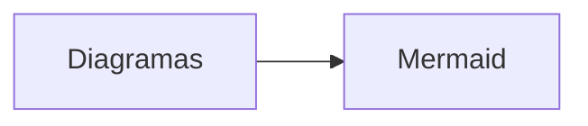

---
# MODELO — copie este arquivo para a pasta da seção, com um nome único (ele vira o slug da URL):
#   notícia    → src/content/blog/noticias/<ano>/meu-texto.md      (secao: noticias)
#   publicação → src/content/blog/publicacoes/<ano>/meu-texto.md   (secao: publicacoes)
#   estudo     → src/content/blog/estudos/<area>/meu-texto.md      (secao: estudos + area)
# Arquivos que começam com "_" são ignorados no build.
title: "Título do texto"
description: "Resumo de 1–2 frases (usado nos cards, buscadores e redes sociais)."
date: "2026-11-08"   # nas notícias, o ano desta data define a página do ano
# updated: "2026-11-20"
# noticias | publicacoes | estudos
secao: publicacoes
# Obrigatório só quando secao: estudos → engenharias | fisica | computacao | economia
# area: computacao
# Use exatamente uma das categorias de src/lib/taxonomy.ts (BLOG_CATEGORIES):
category: "Tecnologia e Inovação"
tags:
  - Exemplo
# Imagem de capa opcional, relativa a este arquivo (otimizada automaticamente):
# cover: ../../../../assets/covers/minha-capa.jpg
# coverAlt: "Descrição da imagem para leitores de tela"
draft: true      # true = só aparece em `npm run dev`
featured: false  # true = destaque na lista da seção
---

Texto de abertura.

## Seção

Markdown comum: **negrito**, _itálico_, [links](https://exemplo.com), listas, tabelas e citações.

```python
print("blocos de código têm destaque de sintaxe")
```


