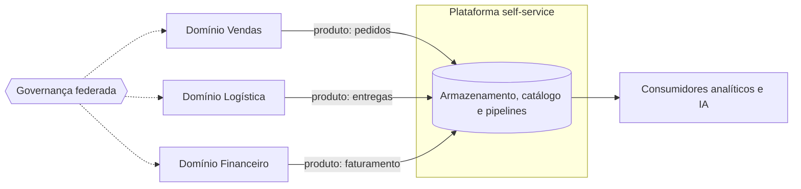

À medida que as organizações crescem, plataformas de dados centralizadas tendem a virar gargalos: um único time passa a receber demandas de todas as áreas, com contexto de negócio limitado sobre cada uma delas. O **Data Mesh** propõe uma mudança de perspectiva — tratar dados como produtos mantidos pelos próprios domínios que os conhecem.

## Os quatro princípios

O conceito, proposto por Zhamak Dehghani, se apoia em quatro princípios complementares:

| Princípio | Ideia central | Pergunta que responde |
| --- | --- | --- |
| Propriedade por domínio | Quem gera e entende o dado é responsável por ele | *Quem cuida deste dado?* |
| Dados como produto | Dados têm consumidores, qualidade e documentação | *Este dado é confiável e fácil de usar?* |
| Plataforma self-service | Infraestrutura comum reduz o esforço de cada domínio | *Como publicar sem reinventar a roda?* |
| Governança federada | Padrões globais, aplicados de forma automatizada | *Como manter interoperabilidade e conformidade?* |

> Data Mesh não é uma ferramenta nem uma arquitetura que se compra pronta: é um modelo socio-técnico. A mudança organizacional pesa tanto quanto a tecnologia.

## Como os domínios se relacionam

O diagrama abaixo ilustra domínios publicando produtos de dados sobre uma plataforma comum, sob regras de governança compartilhadas.



## Um contrato de produto de dados

Um bom ponto de partida é descrever cada produto de dados com um contrato explícito, versionado junto ao código:

```yaml
produto: pedidos-confirmados
dominio: vendas
dono: time-vendas-dados
versao: 1.2.0
descricao: Pedidos confirmados, um registro por pedido.
sla:
  atualizacao: diaria
  disponibilidade: "99,5%"
schema:
  - nome: pedido_id
    tipo: string
    obrigatorio: true
  - nome: valor_total
    tipo: decimal(12,2)
  - nome: confirmado_em
    tipo: timestamp
qualidade:
  - regra: pedido_id e unico
  - regra: valor_total >= 0
classificacao: interno
```

## Quando faz sentido?

O Data Mesh tende a trazer mais benefícios quando:

1. existem **vários domínios** com dados próprios e times com autonomia;
2. o time central de dados se tornou um **gargalo** recorrente;
3. há maturidade para investir em **plataforma** e **automação de governança**.

Para organizações menores, uma plataforma centralizada bem governada costuma ser mais simples e suficiente — e pode evoluir gradualmente para práticas do mesh, como contratos de dados e catálogos.

## Próximos passos

Nos próximos artigos, vamos explorar como implementar contratos de dados, métricas de qualidade e a governança federada na prática.
