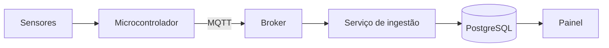

## Contexto e problema

Exemplo: medir o consumo de energia de equipamentos para identificar desperdícios e apoiar decisões de eficiência energética.

## Objetivos

- Coletar leituras de corrente e tensão com microcontroladores;
- Transmitir os dados por um protocolo leve (MQTT);
- Armazenar e visualizar séries temporais.

## Arquitetura

## Resultados

Projeto conceitual de demonstração. Substitua por um projeto real ou remova este arquivo.
